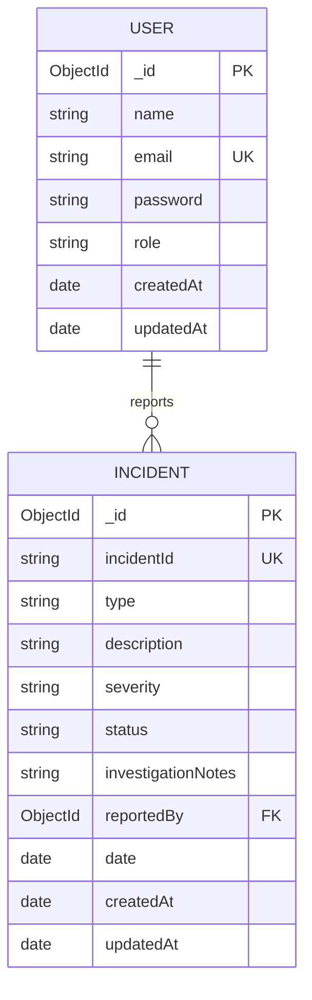

# SecureTrack

SecureTrack is a cybersecurity incident reporting and tracking application. Users can report and manage their own incidents; administrators can review all incidents, update investigation status and notes, and delete incidents.

## Features

- Account registration, login, JWT-protected API routes, and role-based authorization.
- Incident create, read, update, and delete workflows backed by MongoDB.
- Owner-only access for ordinary users and administrator access across incidents.
- A separate administrator page for viewing registered accounts.
- Dashboard analytics for incident status, severity, and type, scoped to incidents visible to the signed-in user.
- A separate incidents page with search, severity/status filters, and incident management actions.
- Dashboard summaries and responsive views.
- Server-side validation, unique incident references, and safe error responses.

## Technology

- Frontend: HTML, CSS, browser JavaScript
- Backend: Node.js and Express.js
- Database: MongoDB with Mongoose
- Authentication: JWT and bcryptjs

## Setup

1. Install a supported Node.js version and run MongoDB locally or use a MongoDB connection string.
2. From `Backend`, install dependencies:

   ```powershell
   cd Backend
   npm install
   ```

3. Copy `Backend/.env.example` to `Backend/.env`. Configure:
   - `PORT`: API port (defaults to `5000`)
   - `MONGODB_URI`: MongoDB connection string
   - `JWT_SECRET`: a long, random signing secret
   - `ADMIN_BOOTSTRAP_KEY`: a secret used only to create the initial administrator
4. Start the API from `Backend`:

   ```powershell
   npm start
   ```

5. Serve the `Frontend` folder using a static web server and open `login.html`. The browser frontend expects the API at `http://localhost:5000`.

The `.env` file is ignored by Git. Do not commit real credentials. `.env.example` contains placeholders only.

## User roles

- **User:** register/login, create incidents, and view, edit, or delete their own incidents. Editable fields are type, description, and severity.
- **Administrator:** view, edit, and delete all incidents, including changing status and investigation notes; view registered accounts on `Frontend/users.html`; and view incident analytics on the dashboard.

The backend checks ownership and roles on every protected incident route; hiding a frontend button is not an authorization boundary.

To create the initial administrator, send the configured bootstrap key to `POST /create-admin` in the JSON `bootstrapKey` field or the `X-Bootstrap-Key` header. Public registration always creates an ordinary user. The bootstrap endpoint rejects creation after an administrator already exists.

## Main API

All routes use JSON. Protected routes require `Authorization: Bearer <token>`.

| Method | Endpoint | Access | Purpose |
|---|---|---|---|
| `POST` | `/register` | Public | Register an ordinary user |
| `POST` | `/login` | Public | Authenticate and receive a token |
| `POST` | `/logout` | Authenticated | End the client session |
| `GET` | `/me` | Authenticated | Read current user profile |
| `GET` | `/users` | Administrator | List registered users without password data on the separate Users page |
| `POST` | `/incidents` | Authenticated | Create incident for current user |
| `GET` | `/incidents` | Authenticated | List accessible incidents; supports `search`, `status`, `severity`, and `type` |
| `GET` | `/incidents/:id` | Owner or administrator | Read incident details |
| `PATCH` | `/incidents/:id` | Owner or administrator | Edit allowed incident fields |
| `PATCH` | `/incidents/:id/status` | Administrator | Change incident status separately |
| `PUT` | `/incidents/:id` | Administrator | Update status and investigation notes (legacy workflow endpoint) |
| `PUT` | `/incidents/:id/notes` | Administrator | Update investigation notes |
| `DELETE` | `/incidents/:id` | Owner or administrator | Delete own incident, or any incident as an administrator |
| `GET` | `/admin/stats` | Administrator | Read aggregate incident statistics |
| `POST` | `/create-admin` | Bootstrap key | Create the initial administrator |

Incident references combine a timestamp and random value and are protected by a unique MongoDB index. The database record's MongoDB `_id` remains the stable resource identifier.

## CRUD workflow

1. Sign in and submit an incident report. The backend validates permitted incident types, severity, and description, then associates the record with the authenticated user.
2. The dashboard shows analytics based on incidents visible to the signed-in user. Open `Frontend/incidents.html` to search, filter, and manage those incidents. Users receive only their own incidents; administrators receive incidents they manage.
3. Open an incident and select **Edit Incident**. Users can edit type, description, and severity. Administrators can additionally update status and investigation notes.
4. The update modifies the existing MongoDB record. Protected identifiers, reporter, and dates are not accepted as editable fields.
5. Incident owners and administrators can select **Delete** and confirm before removing a record. Ordinary users cannot delete another user's incident.

## Data relationship

One user may report many incidents. `Incident.reportedBy` references `User`; legacy incidents without a reporter remain readable by administrators.



## Testing

From `Backend`, run:

```powershell
npm test
```

The integration test suite requires MongoDB at `127.0.0.1:27017`. It starts a separate API process and uses a uniquely named `securetrack_qa_*` database, which it drops during cleanup. It does not use the configured development database. The tests cover registration and login validation, role and ownership enforcement, incident CRUD, concurrent reference generation, filters, invalid IDs, and admin statistics.

## Submission screenshots

For a concise project report, capture the login/register page, ordinary-user dashboard analytics and report form, the incidents page with its detail/edit modal, and the administrator incidents page showing status/notes and delete confirmation. Use only test/demo records and avoid including credentials or real incident data.

## Security note

For compatibility with the static frontend, JWTs are stored in browser local storage. This is suitable only for a controlled demonstration; a production deployment should evaluate HttpOnly, Secure cookies and complete deployment hardening.
